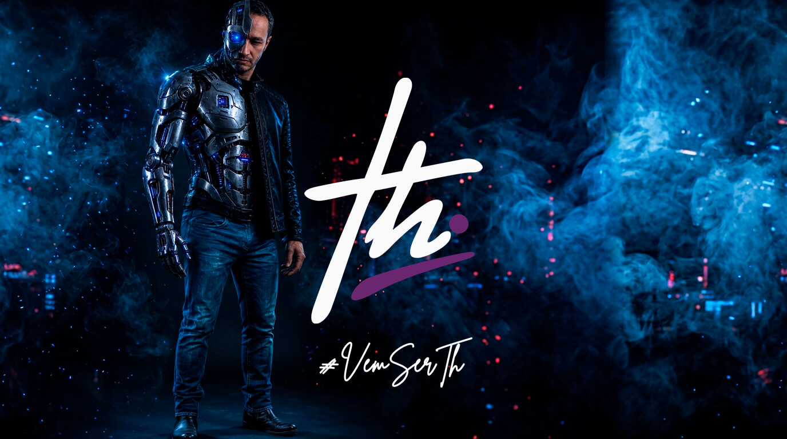
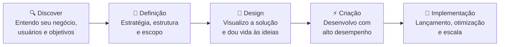

  

<h1 align="center">Pronto pra sair do <i>manual?</i></h1>

  

  
  
  
  

---

## 👋 Eu sou o Th

Construo o futuro com inteligência e tecnologia de ponta. Automação, dados e IA trabalhando juntos para transformar processo manual em sistema inteligente. Projeto e construo a estrutura que coloca a sua empresa no piloto automático, **do primeiro contato ao cliente fiel**.

Moro em Mogi Guaçu/SP e atendo o Brasil todo, de forma remota. São **21+ anos** do primeiro código escrito às automações que rodam hoje.

|  |  |
| --- | --- |
| **🎯 Direto, sem intermediários** | Você fala comigo, não com uma fila de atendimento. Cada projeto passa pela minha mão do início ao fim. |
| **⚙️ Automação de verdade** | Sistemas que entendem a sua operação, não scripts prontos remendados. |
| **📈 Resultado, não relatório** | Entrego o que fecha caixa: processo rodando, dado organizado, cliente atendido. |

---

## ⚡ O que eu faço

<table>
  <thead>
    <tr>
      <th width="30%">Frente</th>
      <th width="70%">O que resolve na prática</th>
    </tr>
  </thead>
  <tbody>
    <tr>
      <td><b>⚙️ Automação de processos</b></td>
      <td>Tarefas repetitivas rodando sozinhas, sem erro e sem depender de alguém lembrar: sincronização de dados entre ferramentas, follow-ups, distribuição de leads, integração entre CRM, ERP, e-mail e pagamentos.</td>
    </tr>
    <tr>
      <td><b>🤖 IA aplicada</b></td>
      <td>Agentes e fluxos com IA que entendem contexto, qualificam, respondem e agendam, em qualquer canal (WhatsApp, site, e-mail, sistemas internos), sempre com a equipe no controle.</td>
    </tr>
    <tr>
      <td><b>🧩 Sistemas sob medida & CRMs</b></td>
      <td>Painéis e plataformas desenhados em volta de como o seu negócio funciona, com níveis de acesso, relatórios e estrutura que cresce junto com a empresa.</td>
    </tr>
    <tr>
      <td><b>🌐 Sites & lojas virtuais</b></td>
      <td>Sites institucionais, landing pages e e-commerces feitos pra converter: rápidos, mobile first, com SEO e um caminho claro até a ação.</td>
    </tr>
    <tr>
      <td><b>🧭 Consultoria técnica</b></td>
      <td>Antes de investir, saber o que vale a pena agora e o que só viraria custo depois. Diagnóstico, prioridades e roadmap.</td>
    </tr>
  </tbody>
</table>

---

## 🏢 Plataformas próprias, já atendendo operações reais

Cada uma nasceu de uma operação real e é adaptada ao jeito de trabalhar de cada cliente.

| Plataforma | Mercado | O que entrega |
| --- | --- | --- |
| **TEKLIN** | 🏠 Imobiliárias | Painel de gestão com agenda de visitas sem conflito entre corretores e o agente **AIrton**, que atende e agenda. |
| **REVIX** | 🚗 Concessionárias | Atendimento, qualificação e distribuição de leads entre vendedores, com follow-up automático e agendamento de visitas. |
| **ODONIA** | 🦷 Clínicas odontológicas | Gestão completa da clínica: agenda multiprofissional, funil de pacientes em 9 etapas e a secretária de IA **Gabriela**. |
| **KAVO** | 💬 Equipes de vendas | CRM que organiza conversas por setor, etapa e responsável, com automações e histórico completo do cliente. |

Os repositórios são privados: cada instalação é feita sob medida para um cliente. Quer ver algum funcionando? <a href="https://wa.me/5519991714331">Me chama</a>.

---

## 🧭 Como eu trabalho

---

## 🧰 A ferramenta vem depois do problema

Escolho a tecnologia pelo que o projeto precisa, não o contrário. Se o problema pedir outra coisa, eu uso outra coisa. No dia a dia isso costuma passar por n8n, Next.js, Supabase e modelos de IA como Claude e OpenAI, mas o que define o projeto é o resultado.

---

## 🤝 Vamos tirar sua operação do manual?

Me conta o que está travando o seu negócio. O primeiro contato é gratuito e sem compromisso: eu entendo o contexto e digo onde tecnologia, automação ou IA realmente trazem retorno.

  
  

  Feito com ♥ pelo Th

